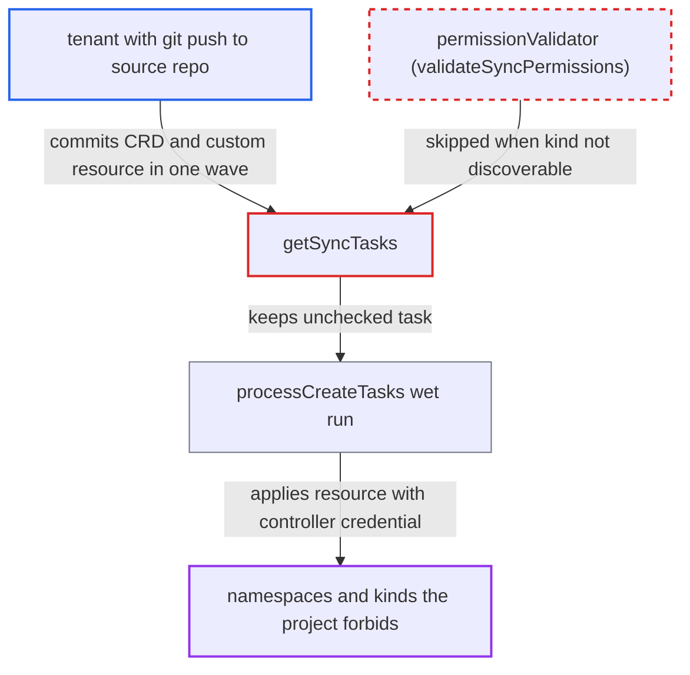

# Sync permission validator skipped for resources whose kind is not yet discoverable

| Field | Value |
|---|---|
| ID | `find_01QeVSJbHD8AGin7c3nbTpxz` |
| Severity | **Low** |
| Status | open |
| CWE | CWE-862 — Missing Authorization |
| Created | 2026-10-27T21:28:21.630036Z |
| Claude Security | https://claude.ai/security/findings/find_01QeVSJbHD8AGin7c3nbTpxz |

## Description

A tenant who can push to an app's source repo can make Argo CD create objects in namespaces the project does not allow, or of kinds the project blocks. The attack works when the project lets the tenant ship a CRD (`CustomResourceDefinition` in `clusterResourceWhitelist`). The cause is `getSyncTasks`, which skips the `permissionValidator` check for kinds that are not yet discoverable but still applies them.

1. **tenant** commits a CRD and a custom resource of that CRD to the source repo. Both go in the same sync wave, and the custom resource sets `metadata.namespace` to a namespace outside the project's `destinations`.
2. **`getSyncTasks`** looks up each task's kind through discovery and gets NotFound for the new kind. The CRD is not installed yet, so the cluster does not serve the custom resource's kind. ([`gitops-engine/pkg/sync/sync_context.go:1106-1125`](https://github.com/cx-benchmark/argo-cd/blob/b7bc418289a96130340ea79964c4491b416c14f2/gitops-engine/pkg/sync/sync_context.go#L1106-L1125))
3. **`shouldSkipDryRunOnMissingResource`** returns true for the task. It is true when the manifest has `SkipDryRunOnMissingResource=true`, when the sync operation sets that option, or when a CRD manifest for the same group and kind is among the target objects, including `hook: Skip` manifests that are never applied. ([`gitops-engine/pkg/sync/sync_context.go:1097-1104`](https://github.com/cx-benchmark/argo-cd/blob/b7bc418289a96130340ea79964c4491b416c14f2/gitops-engine/pkg/sync/sync_context.go#L1097-L1104))
4. **`getSyncTasks`** marks the task `skipDryRun` and keeps it without calling `permissionValidator`. `permissionValidator` is called only in the `else` branch that runs after a successful discovery, and no error is returned, so `successful` stays true. ([`gitops-engine/pkg/sync/sync_context.go:1106-1125`](https://github.com/cx-benchmark/argo-cd/blob/b7bc418289a96130340ea79964c4491b416c14f2/gitops-engine/pkg/sync/sync_context.go#L1106-L1125))
5. **`syncTasks.Sort`** moves the CRD ahead of the custom resource in the same wave. This guarantees the CRD is applied first within one `Sync()` pass. ([`gitops-engine/pkg/sync/sync_tasks.go:116-141`](https://github.com/cx-benchmark/argo-cd/blob/b7bc418289a96130340ea79964c4491b416c14f2/gitops-engine/pkg/sync/sync_tasks.go#L116-L141))
6. **`processCreateTasks`** applies the CRD, waits for it to become ready, then applies the custom resource. `skipDryRun` tasks are skipped only when `dryRun` is true, so in the real run the resource is applied with `kubectl apply` using the controller's cluster credential. ([`gitops-engine/pkg/sync/sync_context.go:1757-1762`](https://github.com/cx-benchmark/argo-cd/blob/b7bc418289a96130340ea79964c4491b416c14f2/gitops-engine/pkg/sync/sync_context.go#L1757-L1762))
7. **Argo CD** creates the custom resource in the forbidden namespace. `validateSyncPermissions` was the only gate for target objects, and `CompareAppState` only marks such targets `Unknown` without raising a blocking condition. ([`controller/state.go:1058-1066`](https://github.com/cx-benchmark/argo-cd/blob/b7bc418289a96130340ea79964c4491b416c14f2/controller/state.go#L1058-L1066))

## Assessment

The attacker is a tenant with git-push access to the app's source repo. Changing the app to point at such content through `applications, update` also works. The project must restrict `destinations` but allow `CustomResourceDefinition` in `clusterResourceWhitelist`. This is commonly granted to teams that deploy operators. The attacker commits a CRD for `evil.io/Thing` and a `Thing` manifest with `metadata.namespace` set to another tenant's namespace, in the same wave, and then syncs. Other triggers for the skipped check are the annotation `argocd.argoproj.io/sync-options: SkipDryRunOnMissingResource=true` on the resource, or the sync operation setting that option. The bypass works whenever the kind becomes servable between task generation and apply.

Impact: The attacker can create, and later update through further syncs, namespaced objects in namespaces outside the project's `destinations`. They can also create objects of kinds in `namespaceResourceBlacklist` or absent from the whitelists. The objects are of a newly defined custom type, so the effect on existing workloads is limited unless a controller consumes them. Examples are finalizers or ownerReferences placed in victim namespaces, and object squatting. The report finds no data disclosure, and any availability effect is incidental.

## Recommendation

`getSyncTasks` treats an undiscoverable API resource as a reason to skip the dry-run. Because `permissionValidator` is called only in the `else` branch of the discovery error check, it also skips project authorization for that task. The task is still applied.

Fix criteria: Every task that can reach `applyObject` has passed `permissionValidator`, or an equivalent check that does not depend on discovery. Such a check could derive scope from the in-sync CRD manifest, or treat unknown-scope resources as both namespaced and cluster-scoped for the allow/deny and destination checks. A CRD plus custom resource pair in one wave fails the sync before anything is applied when the custom resource targets a namespace outside the project's destinations or a kind in `namespaceResourceBlacklist`. The existing `SkipDryRunOnMissingResource` behaviour still skips only the dry-run.

## Evidence

**https://github.com/cx-benchmark/argo-cd**

- [`gitops-engine/pkg/sync/sync_context.go:1106-1125`](https://github.com/cx-benchmark/argo-cd/blob/b7bc418289a96130340ea79964c4491b416c14f2/gitops-engine/pkg/sync/sync_context.go#L1106-L1125)
- [`gitops-engine/pkg/sync/sync_context.go:1097-1104`](https://github.com/cx-benchmark/argo-cd/blob/b7bc418289a96130340ea79964c4491b416c14f2/gitops-engine/pkg/sync/sync_context.go#L1097-L1104)
- [`gitops-engine/pkg/sync/sync_context.go:1757-1762`](https://github.com/cx-benchmark/argo-cd/blob/b7bc418289a96130340ea79964c4491b416c14f2/gitops-engine/pkg/sync/sync_context.go#L1757-L1762)
- [`gitops-engine/pkg/sync/sync_tasks.go:116-141`](https://github.com/cx-benchmark/argo-cd/blob/b7bc418289a96130340ea79964c4491b416c14f2/gitops-engine/pkg/sync/sync_tasks.go#L116-L141)
- [`controller/sync.go:753-776`](https://github.com/cx-benchmark/argo-cd/blob/b7bc418289a96130340ea79964c4491b416c14f2/controller/sync.go#L753-L776)
- [`controller/state.go:1058-1066`](https://github.com/cx-benchmark/argo-cd/blob/b7bc418289a96130340ea79964c4491b416c14f2/controller/state.go#L1058-L1066)

