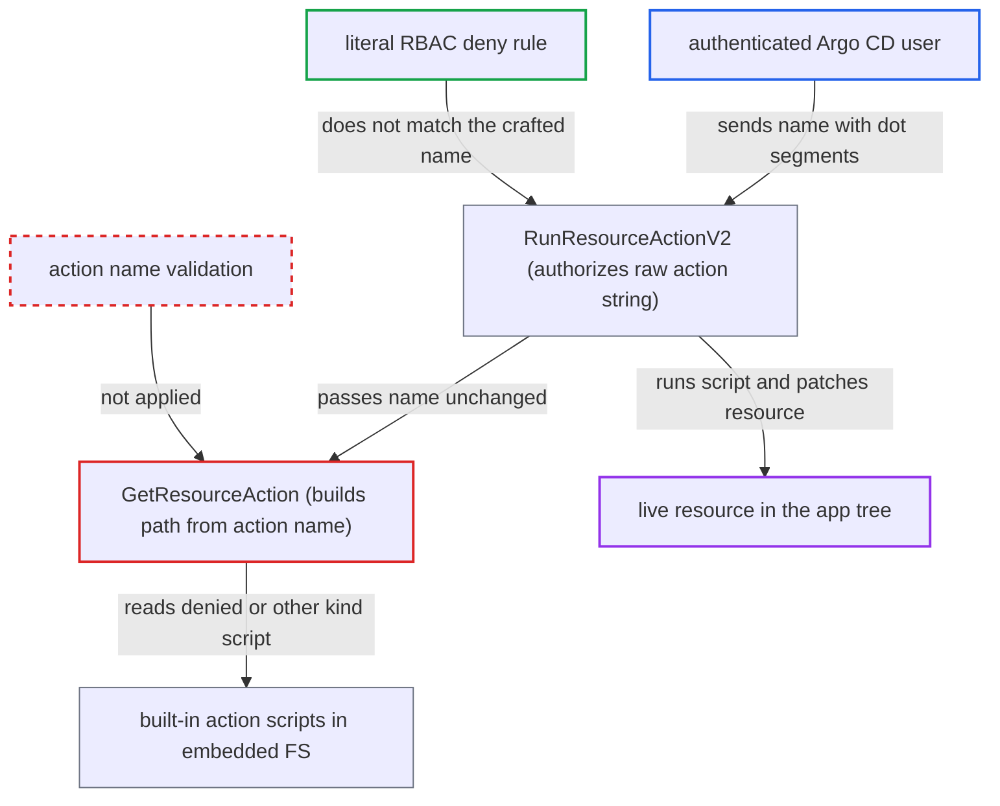

# Unsanitized resource action name lets `.`/`..` segments bypass action RBAC deny rules and kind scoping

| Field | Value |
|---|---|
| ID | `find_01RffJJkFpicHgrM4a9iodBi` |
| Severity | **Low** |
| Status | open |
| CWE | CWE-22 — Path traversal |
| Created | 2026-10-27T21:15:16.126444Z |
| Claude Security | https://claude.ai/security/findings/find_01RffJJkFpicHgrM4a9iodBi |

## Description

A logged-in Argo CD user can run built-in resource action scripts that the operator denied, or that belong to another resource kind, on resources in an app they may already act on. This needs an RBAC policy with a wildcard action allow, such as `action/apps/Deployment/*`. `GetResourceAction` uses the action name in a file path without validation, while RBAC checks the raw name. Impact is limited to what the built-in scripts write.

1. **authenticated user** posts a run-action request with a crafted `action` value. The value carries `.` or `..` segments, for example `./scale`, `restart/../scale` or `../../../argoproj.io/Rollout/actions/abort`, and may include `resourceActionParameters` such as `replicas`.
2. **`RunResourceActionV2`** authorizes the raw string `action/<group>/<kind>/<action>`. The name is not normalized or validated, so the check sees `action/apps/Deployment/./scale` rather than the script that will actually run. ([`server/application/application.go:2697-2721`](https://github.com/cx-benchmark/argo-cd/blob/b7bc418289a96130340ea79964c4491b416c14f2/server/application/application.go#L2697-L2721))
3. **RBAC matcher** matches the allow rule but misses the deny rule. The allow pattern `action/apps/Deployment/*` matches because `*` also matches `/` and `.`. The literal deny `action/apps/Deployment/scale` does not match, and the policy allows anything not denied. ([`util/rbac/rbac.go:288-303`](https://github.com/cx-benchmark/argo-cd/blob/b7bc418289a96130340ea79964c4491b416c14f2/util/rbac/rbac.go#L288-L303))
4. **`GetResourceAction`** puts the unchanged action name into the embedded-FS path. It builds `<group>/<kind>/actions/<actionName>` without rejecting `/`, `.` or `..`. ([`util/lua/lua.go:545-546`](https://github.com/cx-benchmark/argo-cd/blob/b7bc418289a96130340ea79964c4491b416c14f2/util/lua/lua.go#L545-L546))
5. **`getPredefinedLuaScripts`** reads `action.lua` through `filepath.Join`. `filepath.Join` cleans the path lexically, so `.` and `..` resolve to the denied script, or to another kind's script, which is valid in the embedded FS. ([`util/lua/lua.go:578-587`](https://github.com/cx-benchmark/argo-cd/blob/b7bc418289a96130340ea79964c4491b416c14f2/util/lua/lua.go#L578-L587))
6. **`RunResourceActionV2`** runs the resolved script on the live resource and applies the result. The result is applied with the destination cluster credentials. Created objects are limited to the project by `verifyResourcePermitted`. ([`server/application/application.go:2697-2721`](https://github.com/cx-benchmark/argo-cd/blob/b7bc418289a96130340ea79964c4491b416c14f2/server/application/application.go#L2697-L2721))

## Assessment

The attacker is an authenticated Argo CD user with limited RBAC who can already act on resources in an app. No victim interaction is needed. The operator's policy must have a wildcard action allow. One case is an allow such as `action/apps/Deployment/*` with a deny on `action/apps/Deployment/scale`, or `action/*` with a deny on `action/numaflow.numaproj.io/Pipeline/delete`. The attacker posts to `/api/v1/applications/{name}/resource/actions/v2` with `action` set to `./scale`, `restart/../scale` or `delete/.`. Because the request no longer ends in the denied name, even suffix denies such as `action/*/*/delete` are evaded by `delete/.`. The second route is cross-kind. With any `action/<g>/<K>/*` grant, `../../../<g2>/<K2>/actions/<name>` runs another kind's built-in script on the permitted resource. For example, a user allowed only Rollout actions can run `apps/Deployment/actions/scale` on a Rollout. The deprecated `RunResourceAction` forwards to the same code. Exact-name allow policies with no wildcard are not affected.

Impact: The attacker can run built-in action scripts the operator denied, or scripts from other kinds, on resources in the app tree. Examples are setting any replica count through `resourceActionParameters`, changing suspend or pause flags or status fields, deleting via Numaflow `delete`, or creating a Job or Workflow from `create-job` or `create-workflow`. The damage is bounded to what the roughly 100 built-in scripts write, to the app's resources, and to project-permitted kinds and namespaces. Nothing is disclosed.

## Recommendation

`GetResourceAction` in `util/lua/lua.go` puts the untrusted action name into an embedded-FS path, and `filepath.Join` resolves `.` and `..`. The script that runs is therefore chosen by a different name from the one `RunResourceActionV2` authorized.

Fix criteria: Action names containing a path separator or `.` or `..` segments are rejected before both the RBAC check and any embedded-FS read. Alternatively, the resolved path is shown to equal `<group>/<kind>/actions/<name>/action.lua` for the exact authorized name. With `action/apps/Deployment/*` allowed and `action/apps/Deployment/scale` denied, the names `./scale`, `restart/../scale` and `../../../argoproj.io/Rollout/actions/abort` are refused and no script runs. Legitimate action names still work.

## Evidence

**https://github.com/cx-benchmark/argo-cd**

- [`util/lua/lua.go:545-546`](https://github.com/cx-benchmark/argo-cd/blob/b7bc418289a96130340ea79964c4491b416c14f2/util/lua/lua.go#L545-L546)
- [`util/lua/lua.go:578-587`](https://github.com/cx-benchmark/argo-cd/blob/b7bc418289a96130340ea79964c4491b416c14f2/util/lua/lua.go#L578-L587)
- [`server/application/application.go:2697-2721`](https://github.com/cx-benchmark/argo-cd/blob/b7bc418289a96130340ea79964c4491b416c14f2/server/application/application.go#L2697-L2721)
- [`assets/model.conf:10-14`](https://github.com/cx-benchmark/argo-cd/blob/b7bc418289a96130340ea79964c4491b416c14f2/assets/model.conf#L10-L14)
- [`util/rbac/rbac.go:288-303`](https://github.com/cx-benchmark/argo-cd/blob/b7bc418289a96130340ea79964c4491b416c14f2/util/rbac/rbac.go#L288-L303)
- [`docs/operator-manual/rbac.md:194-205`](https://github.com/cx-benchmark/argo-cd/blob/b7bc418289a96130340ea79964c4491b416c14f2/docs/operator-manual/rbac.md#L194-L205)
- [`resource_customizations/embed.go:7-10`](https://github.com/cx-benchmark/argo-cd/blob/b7bc418289a96130340ea79964c4491b416c14f2/resource_customizations/embed.go#L7-L10)

