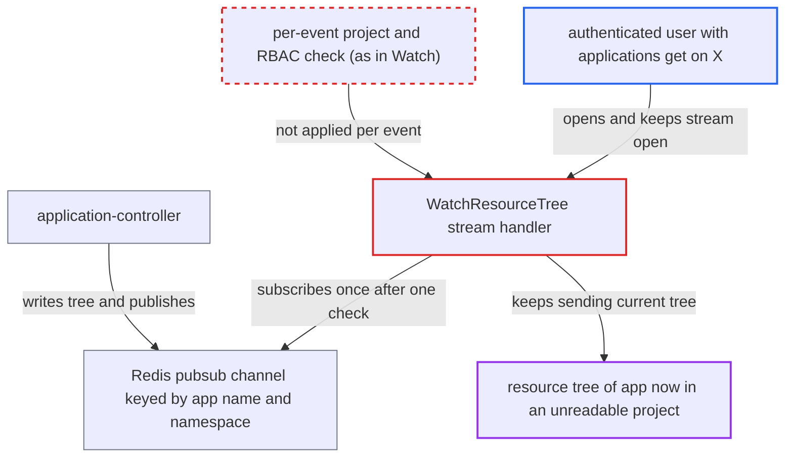

# WatchResourceTree authorizes once and keeps streaming after the app's project, identity or the caller's grant changes

| Field | Value |
|---|---|
| ID | `find_01NRemCaTc574V9mkoAvgsPc` |
| Severity | **Low** |
| Status | open |
| CWE | CWE-863 — Improper authorization |
| Created | 2026-10-27T21:20:19.457847Z |
| Claude Security | https://claude.ai/security/findings/find_01NRemCaTc574V9mkoAvgsPc |

## Description

A logged-in user who can read an application's resource tree can keep receiving that tree after losing the right to read it. The leaked data is resource names, kinds, namespaces, images, health, hostnames and pod names, with no Secret values. The attack needs a stream opened earlier on `WatchResourceTree`. That handler checks `applications, get` only once, and its stream key depends only on the app's name and namespace.

1. **authenticated user** opens the resource-tree stream for app `X` and keeps it open. The user holds `applications, get` on `X` and calls `/api/v1/stream/applications/X/resource-tree` or the gRPC equivalent. ([`server/application/application.go:1663-1678`](https://github.com/cx-benchmark/argo-cd/blob/b7bc418289a96130340ea79964c4491b416c14f2/server/application/application.go#L1663-L1678))
2. **the handler `WatchResourceTree`** checks `applications, get` once and subscribes to tree changes. The check runs through `getApplicationEnforceRBACInformer`, and the subscription is made with `s.cache.OnAppResourcesTreeChanged`. ([`server/application/application.go:1663-1678`](https://github.com/cx-benchmark/argo-cd/blob/b7bc418289a96130340ea79964c4491b416c14f2/server/application/application.go#L1663-L1678))
3. **`argo.AppInstanceName`** builds the stream key from name and namespace only. The key is not tied to the app's UID or project, so a moved or recreated app keeps the same key. ([`util/argo/argo.go:1350-1355`](https://github.com/cx-benchmark/argo-cd/blob/b7bc418289a96130340ea79964c4491b416c14f2/util/argo/argo.go#L1350-L1355))
4. **the Redis subscription loop** keeps the stream running until the client disconnects. The server sets no `MaxConnectionAge` on gRPC and no write timeout on HTTP, and the loop does no re-check. ([`util/cache/redis.go:164-179`](https://github.com/cx-benchmark/argo-cd/blob/b7bc418289a96130340ea79964c4491b416c14f2/util/cache/redis.go#L164-L179))
5. **an admin or another tenant** changes the app or the caller's access. Examples: `spec.project` is moved to a project the caller cannot read, the caller's grant is revoked, or the app is deleted and recreated under the same name.
6. **the application-controller** stores the new tree under the name-based key and publishes on it. It writes under `app.InstanceName(...)` whatever the app's current project is, and each write publishes a notification. ([`controller/appcontroller.go:509`](https://github.com/cx-benchmark/argo-cd/blob/b7bc418289a96130340ea79964c4491b416c14f2/controller/appcontroller.go#L509))
7. **the stream callback** reads the tree stored under the key and sends it to the caller. It does not look up the Application again, compare UID or project, or call the RBAC enforcer, so the caller keeps receiving trees they may no longer read. ([`util/cache/appstate/cache.go:101-121`](https://github.com/cx-benchmark/argo-cd/blob/b7bc418289a96130340ea79964c4491b416c14f2/util/cache/appstate/cache.go#L101-L121))

## Assessment

The attacker is an authenticated user who holds `applications, get` on app `X`. They open the stream (HTTP or gRPC) and leave it open, and the server limits neither stream lifetime nor idle time. They then rely on someone else acting. An admin moves `X` to a project the attacker cannot read, or revokes the attacker's grant, or `X` is deleted and another tenant recreates it under the same name. Each later reconcile publishes on the same name key, and the stream forwards the new tree.

Impact: The attacker keeps read access to the resource tree of an app in a project they cannot read, for as long as the stream stays open. The tree shows resource names, kinds, namespaces, images, health, hostnames and pod names. No Secret values, write access or availability impact is involved.

## Recommendation

`WatchResourceTree` authorizes the caller once, when the stream opens. The stream is identified only by app name and namespace, so later changes to the app's project or identity, or to the caller's grants, are not reflected.

Fix criteria: Each tree event sent on the stream is authorized against the current Application (its project and namespace as they are now, and the same UID as at subscription) and the caller's current RBAC. The stream closes when that check fails. To verify, open a watch, change the app's `spec.project` to one the caller cannot read (or delete and recreate the app), and confirm no further trees are delivered.

## Evidence

**https://github.com/cx-benchmark/argo-cd**

- [`server/application/application.go:1663-1678`](https://github.com/cx-benchmark/argo-cd/blob/b7bc418289a96130340ea79964c4491b416c14f2/server/application/application.go#L1663-L1678)
- [`util/argo/argo.go:1350-1355`](https://github.com/cx-benchmark/argo-cd/blob/b7bc418289a96130340ea79964c4491b416c14f2/util/argo/argo.go#L1350-L1355)
- [`util/cache/appstate/cache.go:101-121`](https://github.com/cx-benchmark/argo-cd/blob/b7bc418289a96130340ea79964c4491b416c14f2/util/cache/appstate/cache.go#L101-L121)
- [`util/cache/redis.go:164-179`](https://github.com/cx-benchmark/argo-cd/blob/b7bc418289a96130340ea79964c4491b416c14f2/util/cache/redis.go#L164-L179)
- [`controller/appcontroller.go:509`](https://github.com/cx-benchmark/argo-cd/blob/b7bc418289a96130340ea79964c4491b416c14f2/controller/appcontroller.go#L509)
- [`server/application/application.go:1237-1335`](https://github.com/cx-benchmark/argo-cd/blob/b7bc418289a96130340ea79964c4491b416c14f2/server/application/application.go#L1237-L1335)

